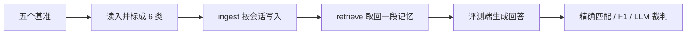

# AgentMemoryBench

评测端统一答题和打分，记忆系统只交回记忆。这样比较的是记忆本身，而不是各家论文自己的答题模型、提示词和指标。

评测中间层与被测记忆系统采用 **C/S 微服务解耦架构**：
评测端作为客户端只负责发送评测流量（调度 Ingest、Retrieve 并统一答题打分），被测记忆系统作为独立 HTTP Server 运行（实现 `/ingest` 与 `/retrieve` 两个核心端点）。

---

## 记忆系统对接协议与接口实体规范 (C/S API Specification)

被测记忆服务（Method Server / Docker 容器）只需暴露以下两个标准 HTTP POST 端点，并统一采用仿 Spring Boot 的 `Result[T]` JSON 信封响应：

### 1. 记忆写入端点 (`POST /ingest`)

以「单次会话（Session，包含该会话的多轮发言）」为标准粒度递交记忆。

- **请求实体 (`IngestRequest`)**：
  - `isolation_key` (`str`，必填)：数据隔离分区键（格式为 `{run_id}_{conversation_id}`），不同对话严格隔离，杜绝数据串扰；
  - `session` (`Session`，必填)：当前会话数据实体：
    - `session_id` (`str`)：当前会话唯一标识符；
    - `session_time` (`str | null`)：当前会话时间锚点（如 `"2023-05-10 14:30:00"`）；
    - `turns` (`list[Turn]`)：会话轮次列表：
      - `turn_id` (`str`)：单轮发言 ID；
      - `speaker` (`str`)：发言人角色标识（如 `"user"`, `"assistant"`, 或真实人名）；
      - `content` (`str`)：发言文本内容（多模态图像已标准化内联为文本描述）；
  - `metadata` (`dict`)：调度元数据，如 `{"is_last_session": true}` 告知会话收口。

**请求体 JSON 范例**：
```json
{
  "isolation_key": "locomo_run1_conv01",
  "session": {
    "session_id": "session_01",
    "session_time": "2023-05-10 14:30:00",
    "turns": [
      {
        "turn_id": "turn_01",
        "speaker": "Alice",
        "content": "Hi Bob, I just moved to Seattle yesterday!"
      },
      {
        "turn_id": "turn_02",
        "speaker": "Bob",
        "content": "Welcome to Seattle! How do you like the weather?"
      }
    ]
  },
  "metadata": {
    "is_last_session": false
  }
}
```

- **响应实体 (`Result[None]`)**：
```json
{
  "code": 200,
  "message": "ok",
  "data": null,
  "latency_ms": 15.2
}
```

---

### 2. 记忆检索端点 (`POST /retrieve`)

根据考题文本和隔离键取回与问题相关的记忆，只返回纯文本 `formatted_memory`，不返回答案。

- **请求实体 (`RetrieveRequest`)**：
  - `isolation_key` (`str`，必填)：必须与写入时的数据隔离键严格一致；
  - `query` (`str`，必填)：需要被回答的问题文本；
  - `question_time` (`str | null`)：提问时间锚点（辅助记忆系统进行相对时间推理）；
  - `question_id` (`str | null`)：考题唯一标识；
  - `metadata` (`dict`)：可选检索扩展信息。

**请求体 JSON 范例**：
```json
{
  "isolation_key": "locomo_run1_conv01",
  "query": "Where did Alice move recently?",
  "question_time": "2023-05-15",
  "question_id": "q_01",
  "metadata": {}
}
```

- **响应实体 (`Result[RetrievePayload]`)**：
```json
{
  "code": 200,
  "message": "ok",
  "data": {
    "formatted_memory": "Alice moved to Seattle on 2023-05-10."
  },
  "latency_ms": 8.6
}
```

---

## 服务端多线程并发要求与处理指南 (Server-Side Concurrency)

评测框架客户端支持通过 `-w` / `--max-workers` 开启高并发评测（如 `-w 10`）。由于多线程是在客户端并发向外部 Memory Server 发起 HTTP 请求，**服务端必须具备相应的并发支撑与数据安全设计**：

```mermaid
flowchart LR
    subgraph Client["评测端 Client (max-workers=10)"]
        W1["Worker 1 (Conv 1)"]
        W2["Worker 2 (Conv 2)"]
        W10["Worker 10 (Conv 10)"]
    end
    subgraph Server["外部 Memory Server (必须支持并发)"]
        ASGI["ASGI 异步网关 (Uvicorn / Gunicorn)"]
        POOL["DB/向量库 连接池 (pool_size >= 10)"]
        LOCK["按 isolation_key 隔离分区<br/>(杜绝跨对话脏写)"]
    end
    W1 -->|POST /ingest (key_1)| ASGI
    W2 -->|POST /ingest (key_2)| ASGI
    W10 -->|POST /ingest (key_10)| ASGI
    ASGI --> POOL --> LOCK
```

### 1. 严格基于 `isolation_key` 隔离存储（杜绝竞态脏写）
并发 Worker 是以独立 Conversation 为调度粒度的。打到服务端的每个请求携带全局唯一的 `isolation_key`（例如 `run01_conv_1` 与 `run01_conv_2`）。
- **服务端红线**：严禁在全局单例变量中追加写入记忆，必须将 `isolation_key` 作为数据库/向量集合的分区主键（Partition Key / Namespace / Collection）；
- 保证多线程同时发起 Ingest 时，Conversation 1 的事实绝不会写入 Conversation 2 的记忆库。

### 2. 生产级 ASGI Web 容器部署
- 避免使用单进程单线程的开发服务器；
- 推荐使用 FastAPI 搭配生产级多 Worker ASGI 容器：
  ```bash
  uvicorn server:app --host 0.0.0.0 --port 8002 --workers 4
  ```

### 3. 数据库与向量库连接池配置
- 如果 Memory Server 底层使用了 PostgreSQL、MySQL、Qdrant 或 Milvus，数据库连接池上限（`pool_size` 与 `max_overflow`）必须大于或等于评测端的 `--max-workers` 线程数；
- 避免连接池排空导致请求阻塞超时（`QueuePool limit exceeded`）。

### 4. 评测端默认保护机制
- **默认单线程安全模式**：如果不显式传 `-w`，评测框架**默认使用 `--max-workers 1`（单线程串行模式）**；
- 任何轻量级、单线程、甚至本地写文件的初级 Memory Demo 都能 100% 稳定运行，不会因并发导致崩溃；只有确认服务端支持并发时才建议调大 `-w`。

---

## 评测题

五个基准的原题按「做对时该回答什么」收成 6 类。总分和这 6 类用同一批题。对不上的原题在加载时去掉。

| 类型 | 做对时 |
| :--- | :--- |
| 事实回忆 | 把已经说过的内容说出来 |
| 多证据综合 | 把好几处说过的内容拼起来 |
| 时间与顺序 | 用日期或先后作答 |
| 记忆更新 | 只答更新后的当前值 |
| 拒答 | 明确说没说过 |
| 个性化 | 偏好已经说过，回答要照着做 |

不进入这 6 类的题包括：LoCoMo 的对抗题和开放域常识题，MemBench 没说破的偏好、情绪、再加工和带噪问题，BEAM 的内部矛盾、指令遵循和长期总结，HaluMem 的错误前提纠正和新情境应用。

打分用三个评测器：精确匹配、F1、LLM 裁判。信息不够时，裁判可以拒绝打分并转人工，而不是猜一个对错。

---

## 流水线



---

## 目录结构

```text
├── configs/
│   └── application.yaml                # 统一配置（LLM 客户端与动态 Prompt 矩阵）
├── src/memory_benchmark/               # 评测中间层核心源码
│   ├── benchmark_adapters/             # 5 大基准加载与 6 类题型过滤适配器 (LoCoMo / LongMemEval 等)
│   ├── core/                           # 核心领域实体、中间层协议 (MemoryProvider) 与安全变量格式化引擎
│   ├── coordinator/                    # 评测协调微服务 (IoC 容器，接收外部容器 /ready 握手编排)
│   ├── readers/                        # 统一回答生成器 (FrameworkAnswerReader 拼接记忆与生成回答)
│   ├── evaluators/                     # 通用评估器 (ExactMatch / F1 / 支持拒判转人工的双模式 LLM-Judge)
│   ├── runners/                        # 执行器 (prediction.py 并发预测与 evaluation.py 离线解耦打分)
│   ├── storage/                        # 评测实验产物管理 (JSON Lines 读写与原子落地)
│   ├── utils/                          # 通用工具 (线程安全运行日志记录器等)
│   └── __main__.py                     # 极简 CLI 命令行入口
├── pyproject.toml                      # 项目元数据与评测必要依赖规范 (无重型依赖冲突)
├── uv.lock                             # 确定性依赖版本锁定文件
├── .env.example                        # 环境变量模板 (API_KEY / BASE_URL / MODEL_NAME)
└── .gitignore                          # 严格白名单过滤规则
```

### 关键目录与模块职责

- [`configs/application.yaml`](configs/application.yaml)：全局基准与差异化覆盖配置中心。定义 `llm.answer` 与 `llm.judge` 默认模型参数，并配置各大 Benchmark 细分题型的定制化 System/User 提示词。
- [`src/memory_benchmark/benchmark_adapters/`](src/memory_benchmark/benchmark_adapters/)：统一数据接口。负责解析原始对话为 `Conversation -> Session -> Turn`，只保留映射进 6 类的有效题，并剥离私有参考答案。
- [`src/memory_benchmark/core/`](src/memory_benchmark/core/)：系统核心抽象层。提供泛型响应封装 `Result[T]`、极简双方法客户端协议 [`HttpMemoryProvider`](src/memory_benchmark/core/provider_protocol.py)，以及免疫 JSON 花括号冲突的安全提示词格式化引擎。
- [`src/memory_benchmark/readers/`](src/memory_benchmark/readers/)：统一答题生成层。将被测记忆系统返回的纯文本 `formatted_memory` 拼入提示词，使用统一配置的 Answer LLM 回答问题。
- [`src/memory_benchmark/evaluators/`](src/memory_benchmark/evaluators/)：统一指标打分层。包括字符串精确匹配 `ExactMatch`、Token 级重叠度 `F1` 以及强类型 Pydantic 双模式的 `LLMJudgeEvaluator`（遇到不可判情况自动标记 `UNDECIDABLE` 拒判转人工复核）。
- [`src/memory_benchmark/runners/`](src/memory_benchmark/runners/)：流水线编排调度层。以对话（Conversation）为粒度进行多线程并发执行，并按原始索引严格确定性归并生成产物。

---

## 运行

评测中间层与被测记忆系统采用 **C/S 微服务解耦架构**：
评测端只负责发送评测流量（调度 Ingest、Retrieve 并打分），被测记忆系统作为独立 HTTP Server 运行（实现 `/ingest` 与 `/retrieve`）。

### 1. 安装 uv 与依赖初始化

推荐使用现代 Python 极速包管理工具 [uv](https://docs.astral.sh/uv/) 初始化环境：

```bash
# 1. 安装 uv (如未安装)
# macOS / Linux:
curl -LsSf https://astral.sh/uv/install.sh | sh
# 或使用 Homebrew:
# brew install uv

# 2. 一键创建虚拟环境并锁定安装依赖
uv sync
```

### 2. 配置环境变量

复制 `.env.example` 为 `.env`，配置用于答题和裁判的大模型参数：

```bash
cp .env.example .env
```

在 `.env` 中填写以下变量（兼容任何提供 OpenAI `/v1/chat/completions` 接口的模型服务或中转地址）：

```bash
API_KEY=your_api_key_here
BASE_URL=https://api.openai.com/v1
MODEL_NAME=gpt-4o-mini
```

### 3. 运行自动化契约测试

在运行真实实验前，可运行测试套件验证代码与文档防漂移契约：

```bash
uv run pytest -q
```

---

### 4. 运行评测实验

#### 方式 A：一键极速冒烟探活（秒级验证外部服务连通性与接口对齐）

启动你的 Memory Server 后，运行一键冒烟命令，验证网络路由与实体反序列化是否正常：

```bash
uv run memory-benchmark run --smoke --server-url http://127.0.0.1:8002
```

> **`--smoke` 的作用**：自动安全锁定为「1 个会话、1 个 Session、1 道考题」，在真实网络层仅触发 1 次 `POST /ingest` 与 1 次 `POST /retrieve`，秒级跑通全流程，避免长会话建库等待与 Token 浪费。

#### 方式 B：全量生产端到端评测（默认全量数据）

通过 `--server-url` 指定你的 Memory Server 真实访问地址（默认全量评测）：

```bash
uv run memory-benchmark run \
  -b locomo \
  --server-url http://127.0.0.1:8002 \
  --metrics f1
```

#### 方式 C：流水线阶段解耦分步执行（写入 / 答题 / 打分 物理分离）

当被测记忆系统入库耗时较长，或需要多次调试 Prompt / 指标时，可分步执行：

```bash
# 阶段 1：仅将长对话历史注入外部记忆服务（不发题、不调答题 LLM）
uv run memory-benchmark ingest -b locomo --server-url http://127.0.0.1:8002

# 阶段 2：仅检索记忆并生成回答（假设数据已写入，不重复 Ingest）
uv run memory-benchmark query -b locomo --server-url http://127.0.0.1:8002

# 阶段 3：仅离线计算评估打分（强绑定 --run-dir 与 --metrics，无需再打扰 Memory Server）
uv run memory-benchmark eval --run-dir outputs/locomo_http --metrics f1,exact_match
```

---

## 命令行参数完整参考 (CLI Reference)

AgentMemoryBench 采用 **子命令（Subcommand）流水线架构**，各阶段职责与参数独立，杜绝隐式依赖耦合：

| 子命令 (Subcommand) | 核心职责 | 典型调用场景 |
| :--- | :--- | :--- |
| `run` *(缺省默认)* | 一站式全流程评测 (Ingest $\rightarrow$ Query $\rightarrow$ Evaluate) | 日常全量评测、冒烟验收 |
| `ingest` | 阶段一：仅向 Memory Server 写入长对话 Session 历史 | 耗时记忆预热、持久化建库 |
| `query` | 阶段二：仅根据已写入的记忆检索并生成回答 | 调试答题 Prompt、更换回答模型 |
| `eval` | 阶段三：仅离线读取已有产物打分（强绑定 `--metrics`） | 多指标离线复评、无 Token 损耗复验 |

### 1. 核心通用参数 (Global & Data Options)

适用于 `run`、`ingest`、`query` 子命令（直接执行 `memory-benchmark [options]` 默认作为 `run` 处理）：

| 参数 (Option) | 短选项 | 默认值 | 取值范围 / 示例 | 说明 |
| :--- | :--- | :--- | :--- | :--- |
| `--benchmark` | `-b` | `locomo` | `locomo`, `longmemeval`, `halumem`, `beam`, `membench` | 目标评测基准数据集。 |
| `--smoke` | - | `False` | 标志位（无需值） | **一键安全冒烟模式**：强制锁定为 1 个会话 + 1 个 Session + 1 道题，秒级完成全链路验证。**不传时默认 100% 全量评测**。 |
| `--server-url` | `-u` | `http://127.0.0.1:8002` | `http://127.0.0.1:8002` | 被测 Memory Server 的真实 HTTP 根地址。 |
| `--max-workers` | `-w` | `1` | 整数（如 `4`, `10`） | 会话级多线程并发 Worker 数。评测自动按原始索引确定性升序归并产物。 |
| `--run-id` | - | 自动生成 | 字符串（如 `exp_locomo_01`） | 显式指定实验运行 ID，产物统一持久化在 `outputs/{run_id}/`。 |
| `--project-root` | - | `.` | 路径字符串 | 项目根目录路径。 |

### 2. 评测打分与模型控制 (Metrics & LLM Options)

适用于 `run`（在线打分）与 `eval`（离线重打分）：

| 参数 (Option) | 短选项 | 默认值 | 取值范围 / 示例 | 说明 |
| :--- | :--- | :--- | :--- | :--- |
| `--metrics` | - | `f1` | `f1`, `exact_match`, `llm_judge` | 逗号分隔的评估指标列表，如 `--metrics f1,exact_match`。在 `eval` 模式下为核心评估依据。 |
| `--mock-llm` | - | `False` | 标志位（无需值） | 强制使用本地确定性 Fake 客户端生成回答，绝不发起外部 LLM API 请求（适用于 `run` 与 `query` 离线测试）。 |

### 3. 离线打分专属选项 (Offline Eval Options)

仅适用于 `eval` 子命令：

| 参数 (Option) | 短选项 | 默认值 | 取值范围 / 示例 | 说明 |
| :--- | :--- | :--- | :--- | :--- |
| `--run-dir` | - | **必填** | `outputs/locomo_http` | 目标实验输出目录（包含 `method_predictions.jsonl`）。 |

---

## 常用评测场景示例 (Cookbook)

#### 场景 1：一键极速冒烟探活（秒级验证外部服务连通性）
```bash
uv run memory-benchmark run --smoke --server-url http://127.0.0.1:8002
```

#### 场景 2：全量真实评测（默认全量数据，对接外部微服务）
```bash
uv run memory-benchmark run \
  -b locomo \
  --server-url http://127.0.0.1:8002 \
  --metrics f1
```

#### 场景 3：10 线程高并发加速评测（推荐用于 LoCoMo 全量 10 个独立会话）
```bash
uv run memory-benchmark run \
  -b locomo \
  --server-url http://127.0.0.1:8002 \
  -w 10 \
  --metrics f1
```

#### 场景 4：多指标复合评测（同时运行 F1 与精确匹配）
```bash
uv run memory-benchmark run \
  -b locomo \
  --server-url http://127.0.0.1:8002 \
  --smoke \
  --metrics f1,exact_match
```

#### 场景 5：离线二次评估（无需再次请求 Memory Server 与重复消耗 Token）
```bash
uv run memory-benchmark eval \
  --run-dir outputs/locomo_http \
  --metrics exact_match,llm_judge
```
